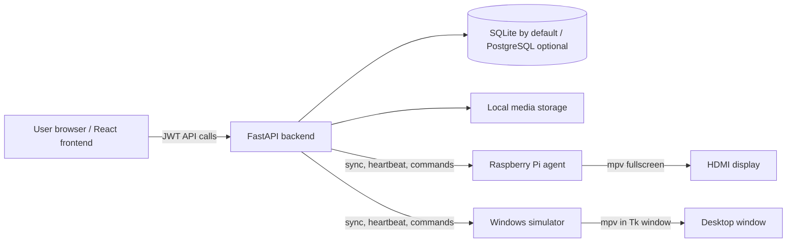

# Architecture

SoulFrame uses a browser dashboard, a FastAPI service, and polling display clients. The system is deliberately pull-based: a device asks for work, which keeps the client usable on private LANs without requiring an inbound connection to the frame.

## Authentication and identity

- A person signs up or logs in at `/auth/*`; the frontend stores the returned JWT and sends it as `Authorization: Bearer …`.
- A display registers once at `/device/register`. The response contains a permanent `device_id` and `device_token`, persisted only in that client's configuration file.
- The display requests a short-lived pairing code. A signed-in person claims it through `/devices/claim`.
- Device API calls use `X-Device-Token` and optionally `X-Device-Id`; they do not use a user JWT.

## Assignment and synchronization

Each device has one assignment: either a direct media item or a playlist. An assignment changes the device content revision. During `POST /device/sync`, the backend compares the device's known content/config revisions and returns the current assignment, download metadata, runtime configuration, and pending commands when needed.

The agent downloads only ready normalized media. It keeps a local checksum index and reuses cached files when the server checksum is unchanged. If the network goes away, the current local playback can continue; sync and telemetry resume when connectivity returns.

## Media pipeline

1. A user uploads an allowed image or video to `POST /media/upload`.
2. The API writes the original asset and creates a media row, then starts a FastAPI background task.
3. Video input is normalized with FFmpeg to an MP4/H.264/AAC/yuv420p playback rendition (up to 1080p, `+faststart`). Metadata is read with ffprobe.
4. A ready video receives a JPEG thumbnail near 25% of its duration. Thumbnail failure is recorded but does not invalidate device playback.
5. Browser cards request ownership-checked, five-minute signed thumbnail/preview URLs. Device downloads instead use device authentication and only work for assigned content.

Existing ready videos can be backfilled with `python -m app.scripts.backfill_thumbnails` from `soulframe-backend`. The command is idempotent.

## Runtime telemetry and commands

Device heartbeats update the latest runtime snapshot: state, local IP, app version, uptime, free storage/cache, active media or playlist, Pi temperature/frequency where available, dropped frames, playback errors, last error, and a recent log tail. The dashboard reads this snapshot; it is not a historical observability system.

Dashboard commands are queued in the database and delivered on a later sync. The device acknowledges a result. Supported commands are `refresh_now`, `restart_playback`, `clear_cache`, `reboot_client`, `unassign_content`, `run_health_check`, and `debug_message`.

## Storage and migrations

`MEDIA_STORAGE_PATH` defaults to `./data/media` relative to the backend. Source files, normalized renditions, and thumbnails have distinct stable keys. SQLAlchemy creates tables at startup for local convenience, while Alembic migrations are the controlled schema-upgrade path. The current migrations cover the initial schema, media processing, direct assignment/runtime telemetry, and thumbnails.

## Client variants

The Pi agent uses `/home/admin/soulframe` and starts fullscreen mpv. The Windows simulator deliberately keeps identity, media, cache, and logs under `%LOCALAPPDATA%\SoulFrameSimulator`; it shares `device_protocol.py` with the Pi client but does not emulate Pi-only hardware sensors.
